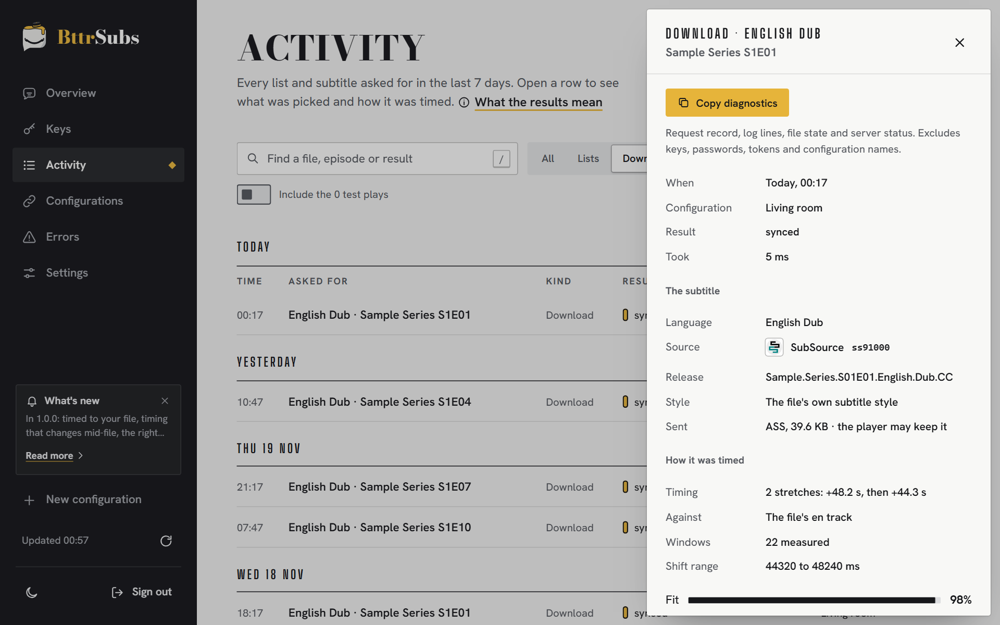
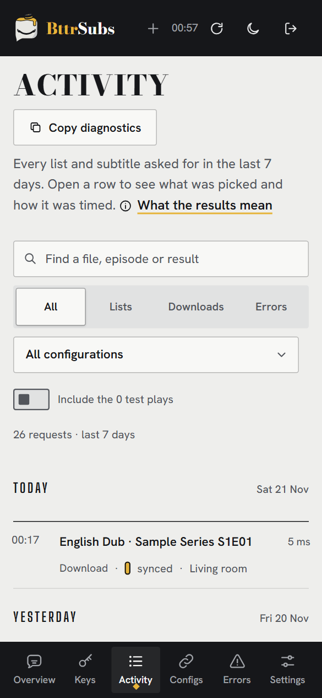

<p align="center">
  
</p>

<h1 align="center">BttrSubs</h1>

<p align="center"><b>Smooth, buttery subtitles. Synced better.</b></p>

<p align="center">
  <a href="https://github.com/jager-gg/BttrSubs/actions/workflows/test.yml"></a>
  <a href="https://github.com/jager-gg/BttrSubs/releases/latest"></a>
  <a href="https://github.com/jager-gg/BttrSubs/pkgs/container/bttrsubs"></a>
  <a href="LICENSE"></a>
</p>

<p align="center">
  
  
</p>

BttrSubs is a self-hosted subtitle addon for [AIOStreams](https://github.com/Viren070/AIOStreams). It finds subtitles for what you're playing and retimes each one to your exact file. It was built for anime watched in English dub, and it works for any film or series.

## Features

- **Synced to your file.** BttrSubs reads the timing of the subtitles inside the file you're playing and moves each downloaded subtitle to match. A file with no subtitles is timed by the speech in its audio.
- **English Dub captions.** Subtitles written from the English dub, so the words match the voices. When none exist, official English closed captions are used.
- **Regular English.** A separate choice, for watching in the original language.
- **Other languages.** The best subtitle for each language you pick. Official translations rank first, and machine translations are left out unless you allow them.
- **Many sources.** SubSource, SubDL, Wyzie Subs, OpenSubtitles, TheSubtitleDB, Gestdown, Anime Tosho and Subtitle Cat, plus up to 3 other Stremio subtitle addons. Results from all of them are ranked together.
- **Your own subtitles.** Put a subtitle no site has in a folder on the server and it is offered like the rest.
- **A configuration per person.** Each person has their own configuration with their own keys, encrypted into their install URL.
- **Dashboard.** What was played, errors, API limits per key, each configuration, and settings you can change without a restart. It works on a phone.

How matching, ranking and syncing work is in [docs/how-it-works.md](docs/how-it-works.md).

## Requirements

- Docker with Compose.
- AIOStreams, your own or a public instance. BttrSubs uses it to find the file you're playing, so each person needs an AIOStreams configuration.
- An address that AIOStreams and your players can reach. Use HTTPS if Stremio apps will use it: Stremio's web app only loads subtitles over HTTPS.
- Optional: a free [SubSource](https://subsource.net/api), [SubDL](https://subdl.com/panel/api) or [Wyzie Subs](https://sub.wyzie.io/redeem) key per person. The other sources need no key.

BttrSubs uses about 30 MB of memory when idle. Most .mkv files are timed from their index, which is about 1 MB and takes about a second. Other files take about 10 seconds of CPU and a read of roughly 14% of the file.

**No telemetry.** BttrSubs reports nothing about your server, its configurations or what was played. ONNX Runtime, the library that runs the speech model, sends usage data to Microsoft by default. BttrSubs turns that off (`ORT_DISABLE_TELEMETRY=1`) in its image and in its code, so it is off however you run it.

## Installation

BttrSubs is published as an image (`ghcr.io/jager-gg/bttrsubs`, amd64 and arm64). You need the compose file and the settings file:

```bash
git clone https://github.com/jager-gg/BttrSubs.git
cd BttrSubs
cp .env.example .env
cp docker-compose.example.yml docker-compose.yml
```

Edit `.env`:

```bash
CONFIG_SECRET=        # openssl rand -hex 32
PUBLIC_BASE_URL=https://subs.example.com
OWN_AIOSTREAMS=https://aiostreams.example.com
ADMIN_PASSWORD=       # required, for the dashboard
ADDON_PASSWORD=       # optional, for /configure
```

Start it:

```bash
docker compose up -d
```

Then open `<PUBLIC_BASE_URL>/configure`.

To build it yourself, swap `image` for `build: .` in `docker-compose.yml` (both lines are there) and run `docker compose up -d --build`. The tests run during the build, so a broken build never starts.

## Setting up a configuration

Open `/configure` and follow its six steps.

### 1. Connect AIOStreams

Enter three things:

| Field | What to enter |
|---|---|
| Address | The address you open AIOStreams at |
| UUID | In AIOStreams: **Save & Install → Your UUID** |
| Password | The password of that AIOStreams configuration |

BttrSubs signs in when you leave a field, never while you type. It then shows what each kind of app needs:

| Where you watch | What it needs |
|---|---|
| The AIOStreams app, or Jellyfin apps connected to AIOStreams | Nothing more |
| Stremio, or apps that use Stremio addons | A linked account. In AIOStreams: **Save & Install → Linked accounts → Link an account → Stremio**, then **Push** |
| Jellyfin apps connected to AIOMetadata | The URL from AIOMetadata: **Jellyfin → Make titles play → Stream addon for everyone** |

The password is stored encrypted inside your BttrSubs install URL and sent only to your AIOStreams. Nothing in AIOStreams is changed unless you press **Add to AIOStreams** on the last step.

If you run your own AIOStreams, set **Pipeline cache TTL** to `60` in its admin settings. Why each of these is needed is explained in [docs/aiostreams.md](docs/aiostreams.md).

### 2. Choose your sources

OpenSubtitles, TheSubtitleDB, Gestdown and Anime Tosho need no key and start switched on. Add a SubSource, SubDL or Wyzie Subs key to search those too, and paste the manifest URL of any other subtitle addon you use.

Subtitle Cat starts switched off. It finds uploads the other sites lack, such as fan translations, but only by name, so one of its subtitles is listed only after it has synced to your file.

### 3. Pick your languages

- **English Dub:** captions written from the English dub, for watching dubbed.
- **English:** regular subtitles, for watching in the original language.
- **Any other language:** its best subtitle.

### 4. Set your filters

| Switch | Starts | When it's on |
|---|---|---|
| Skip languages the file already has | On | A language the file already has full subtitles in is left out. English Dub is always listed |
| Machine and AI translations | Off | They can be picked too, ranked below every other subtitle |
| Only subtitles that sync | Off | A subtitle that can't be synced to your file is left out, instead of listed as not synced |

You also choose whether hearing-impaired subtitles are included, left out or the only ones picked, and how many subtitles each language lists.

### 5. Choose how they look

| Switch | Starts | When it's on |
|---|---|---|
| Keep the subtitle's own styling | On | A subtitle uploaded as ASS keeps its fonts, colours and positions. Off sends every subtitle as plain SRT |
| Remove sound descriptions | Off | [door creaks], (laughs), sung ♪ lines and speaker names like JOHN: are taken out. The timing stays the same |
| Signs & songs with English Dub | Off | Anime only. The on-screen text and song lines a fan release typesets are shown with English Dub, timed to your file. Needs a player that shows ASS |
| Use your file's subtitle style | Off | English Dub and English take the font, size and colours of the subtitles inside your file |

Below the switches you can add **styles**: a look, a height on screen, or both, for all subtitles, anime, series, films or one show.

Each of these is described in full in [docs/configuration.md](docs/configuration.md#switches-in-detail).

### 6. Name it and create

Create the configuration, then press **Add to AIOStreams**: BttrSubs adds itself to your AIOStreams as a subtitle addon. To do it by hand instead, in AIOStreams: **Addons → Add addon → Custom**, paste the install URL as the Manifest URL, tick **Subtitles** under Resources, and set **Timeout** to the number the configure page names (11,000 ms unless `LIST_BUDGET_MS` is changed): AIOStreams drops a list that takes longer than its timeout.

To change settings later, click **Reconfigure** on BttrSubs in AIOStreams. Saved keys are kept unless you replace them, and the install URL stays the same.

To share the server, give people `<PUBLIC_BASE_URL>/configure`, and the `ADDON_PASSWORD` if you set one. Each person uses their own keys and their own AIOStreams.

## Track names

Each track's name in the player says how it is timed:

| Label | Meaning |
|---|---|
| Synced | Timed to the file you're playing |
| Auto sync | Its timing wasn't finished when the list was sent. It is timed by the time it downloads, and says Synced from the next list on |
| Synced by audio | Timed by the voices in the audio, for a file with no subtitles of its own |
| Audio sync | That timing by the voices is still under way |
| No timing word | It couldn't be timed to this file and is sent as it came |

`Dub` marks captions of the English dub, `CC` marks official English captions standing in for them, and `Signs` means signs & songs are in the track.

## Settings

Set these in `.env`. Most can also be changed on the dashboard without a restart; the last column says which.

| Variable | Default | What it does | Dashboard |
|---|---|---|---|
| `CONFIG_SECRET` | required | Encrypts each person's configuration into their install URL. 32 or more characters. Changing it breaks every install URL | No |
| `PUBLIC_BASE_URL` | required | The addon's address as AIOStreams and players reach it, without a trailing slash | No |
| `ADMIN_PASSWORD` | required | Password for the dashboard, 8 or more characters. It opens the configure page too | No |
| `ADDON_PASSWORD` | none | Password for the configure page. Without one, anyone who can reach the page can create a configuration | Yes |
| `OWN_AIOSTREAMS` | none | Your AIOStreams' public address | Yes |
| `AIOSTREAMS_BASE` | `OWN_AIOSTREAMS` | Where this container reaches your AIOStreams, if not at its public address. For example `http://aiostreams:3000` on a shared Docker network | Yes |
| `ALLOWED_AIOSTREAMS` | public instances | The other AIOStreams instances accepted, as comma-separated origins. Set it to your own to accept only that one | Yes |
| `OPENSUBTITLES_API_KEY` | none | OpenSubtitles' own API key, one for the whole server. With it, machine translations from OpenSubtitles are recognised and can be left out | Yes |
| `LIST_BUDGET_MS` | `8000` | How long a subtitle list may take before it answers with what it has, in ms | Yes |
| `MAX_SUBTITLES_PER_LANGUAGE` | `3` | The most subtitles a configuration may list for one language, 1 to 3 | Yes |
| `DAILY_READ_GB` | `20` | The most data read from playing files in a day, across everyone. `0` for no limit | Yes |
| `PRIVATE_STREAM_HOSTS` | none | Hosts on a private network that playing files may be read from, such as a stream proxy on your LAN | Yes |
| `RESULT_CACHE_TTL_SECONDS` | `21600` | How long subtitle search results are cached | Yes |
| `ANIDB_CLIENT`, `ANIDB_CLIENT_VER` | none | An AniDB HTTP API client, used to tell an anime's seasons apart by title | Yes |
| `ANIME_TITLES_DATASET` | `on` | Without an AniDB client, read season titles from the anime-offline-database instead | Yes |
| `CAPTIONS_DIR` | `captions` | The folder of subtitles kept on the server (see [below](#subtitles-kept-on-your-server)) | No |
| `TIME_ZONE` | `UTC` | The time zone the dashboard shows times in, as an IANA name | Yes |
| `UPDATE_CHECK` | `on` | Once a day, ask GitHub whether a newer release is out, so the dashboard can say so | Yes |
| `LOG_DAYS` | `7` | Days of log files kept in the cache volume. `0` keeps none | Yes |
| `LOG_MAX_MB` | `50` | The most the log files take together | Yes |
| `PORT` | `7000` | The port inside the container | No |

The longer notes on these, including the limits BttrSubs keeps with AniDB and the timeout AIOStreams needs for `LIST_BUDGET_MS`, are in [docs/configuration.md](docs/configuration.md).

## Exposing it

| Path | Used by | Protect it |
|---|---|---|
| `/manifest.json`, `/<token>/manifest.json`, `/<token>/subtitles/…`, `/<token>/download/…`, `/logo.png` | AIOStreams and players | No. These must stay open. An install URL's token is long and encrypted, so it can't be guessed |
| `/configure`, `/<token>/configure` | People creating or editing a configuration | Yes, with `ADDON_PASSWORD` or your proxy's login |
| `/dashboard` | You | Always, with `ADMIN_PASSWORD`. It shows what was played and changes settings |

Signing in lasts 30 days. After 5 wrong passwords from one address, sign-in waits 15 minutes. A reverse proxy is trusted for the visitor's address only when it runs on the same machine or a private network.

With an SSO proxy such as Pangolin or Authelia, you can leave `ADDON_PASSWORD` unset. Let the addon's paths bypass the login and keep the login on everything else. These five path rules are all it needs (in Pangolin: Access Rules, action Bypass Auth, match type Path):

```text
manifest.json
*/manifest.json
*/subtitles/*
*/download/*
/logo.png
```

To keep BttrSubs off the internet, run it on the same Docker network as AIOStreams and set `PUBLIC_BASE_URL=http://bttr-subs:7000`. This works for players that fetch subtitles through a server, such as AIOMetadata for Jellyfin apps. It doesn't work for Stremio apps.

## Subtitles kept on your server

For a subtitle no site has, put the file in the folder the server reads (`CAPTIONS_DIR`). In Docker, mount it read-only: the commented `./captions:/app/captions:ro` line in `docker-compose.example.yml` does that. Every configuration is offered these subtitles, and they are synced to the playing file like any other.

Use one folder per title, named by its IMDb id, and one file per episode or film:

```
captions/tt0000001/S03E02.en.dub.srt   English captions of the dub, season 3 episode 2
captions/tt0000001/S03E02.es.ass       a Spanish subtitle for the same episode
captions/tt0000002/film.en.srt         a film's English subtitle
```

The language is a two or three letter code, and English when left out. `.dub` marks captions that follow the dub's words, which English Dub lists. A file you replace is picked up on the next list. Back this folder up yourself: nothing else holds these files.

## Dashboard



`/dashboard` needs `ADMIN_PASSWORD`. It has six sections (keys `1` to `6`):

- **Overview:** a verdict on the last 24 hours, each configuration's requests, the week's figures, CPU and data per day, and each source's week.
- **Keys:** each SubSource, SubDL and Wyzie Subs key against its free plan. Keys show as short hashes, never in full.
- **Activity:** every list and subtitle asked for in the last 7 days, with a find box (`/`). Open a row to see how a subtitle was timed and how well it fits the file.
- **Configurations:** each one's languages, sources, AIOStreams, switches and week.
- **Errors:** what failed in plain words, what to do about it, and whether the request still answered with the other sources.
- **Settings:** the settings marked Yes in the table above, the logs, and clearing the errors or the activity (with Undo).

From **Configurations**, a configuration can be:

- **Opened in configure** to change its settings. Its install URL stays the same.
- **Copied:** **Copy install URL** puts its install URL on the clipboard. The URL is fetched when you press the button, so it is never written into the page.
- **Renamed.** Its install URL stays the same.
- **Paused.** Its subtitle lists are empty and its downloads refused until it's resumed.
- **Deleted,** after a confirm step that names it. Its install URL stops working for good. Its usage history stays.

The dashboard never shows an install URL's token or keys. A configuration appears there once it has been used.

Settings changed on the dashboard are saved in the cache volume (`settings.json`). Each one shows whether its value comes from the dashboard, `.env` or the default, and can be reset. A password set there is stored as a hash. Changing it signs out everyone who used the old one, except you. Removing an AIOStreams instance stops the configurations that use it until it's added back.

**What's new and updates.** The sidebar shows what's new in the running version. When a newer release is out, it shows an **Update available** card with the release notes. To know about a release, BttrSubs asks GitHub's public API once a day. That request sends nothing about your server, its configurations or what was played. Turn it off in Settings or with `UPDATE_CHECK=off`. BttrSubs never updates itself.

**On a phone's home screen.** Add the dashboard or the setup page to the home screen and it opens as an app.

**Testing without skewing the numbers.** Mark a configuration, or all of them, as debug while you test. Marked plays stay out of the dashboard's numbers, and **Include the test plays** shows them:

```sh
docker exec bttr-subs node dist/debugMark.js start <configuration name or id> [note]
docker exec bttr-subs node dist/debugMark.js stop
docker exec bttr-subs node dist/debugMark.js status
```

`mark <from> <to> <configuration|all>` marks a stretch that already happened (ISO times), and `unmark <id>` removes a mark.

**Changes are protected.** Every change needs the admin session, must come from the dashboard itself (same origin, with the page's CSRF token), and is limited to 30 a minute per address. Five refused changes from one address lock it out of changes for 15 minutes. Logs name the setting or configuration that changed, never a value.

## Backups and updates

- Back up `CONFIG_SECRET`. Without it, every install URL stops working.
- Back up `links/` and `settings.json` in the cache volume. `links/` holds settings edited from the configure page and the configurations paused or deleted on the dashboard. `settings.json` holds settings changed on the dashboard. `stats/` holds the dashboard's history, and everything else rebuilds itself. Compose names the volume `<folder>_bttr-subs-cache`:

  ```bash
  docker run --rm -v "$(docker volume ls -q --filter label=com.docker.compose.volume=bttr-subs-cache)":/c:ro -v "$PWD":/out alpine sh -c 'cd /c && tar -czf /out/bttr-subs-backup.tgz $(ls -d links stats settings.json 2>/dev/null)'
  ```

- Update with `docker compose pull && docker compose up -d`, or let an image updater such as Watchtower or Diun do it. The image tag `:1` follows every 1.x release, `:latest` follows everything, and an exact version such as `:1.0.0` stays put. What changed in each version is in [CHANGELOG.md](CHANGELOG.md).
- If you build from source, update with `git pull && docker compose up -d --build`. If the build fails, the running container keeps running.

## Troubleshooting

- **The logs.** `docker compose logs` shows the container's log since it last started, and an update replaces the container. BttrSubs also keeps its log in the cache volume (`logs`, one file per UTC day), so it survives updates. **Settings → Data → Download logs** gives it as one file. Addresses in it keep only their host and long tokens are cut, but it names what was played, so read it before you share it.
- **A subtitle opens with "the file playing isn't in your AIOStreams list any more".** BttrSubs couldn't find the file you played, usually because a release failed and AIOStreams switched to another one. Pick the stream again, or another one. If you watch in Stremio, link your account in AIOStreams (step 1 above): BttrSubs can then ask for the same list Stremio was given.
- **A track shows one line, "no subtitle found for this track fits this file".** None of the subtitles found for that language could be matched to your file, for example because they were timed to a different cut of it.
- **`the file's host refused reads` in the logs.** The debrid or usenet host answered 429, or 403 three times in a row. Reads from that host pause for 5 minutes, doubling up to an hour if it keeps refusing. Subtitles are listed unsynced in the meantime.
- **Changes don't show up.** AIOStreams caches subtitle lists. Clear its `subtitles` cache. If you use AIOMetadata, restart it too: it caches them for an hour.

## Development

```bash
npm ci
npm test
npm run typecheck
npm run dev        # needs a .env
```

See [CONTRIBUTING.md](CONTRIBUTING.md) before opening a pull request.

## Credits

- Built for [AIOStreams](https://github.com/Viren070/AIOStreams) by Viren070, which it uses to find the file being played.
- Speech detection by [Silero VAD](https://github.com/snakers4/silero-vad) (MIT).

## License

[AGPL-3.0](LICENSE). Bundled third-party files: [THIRD_PARTY_NOTICES.md](THIRD_PARTY_NOTICES.md).
